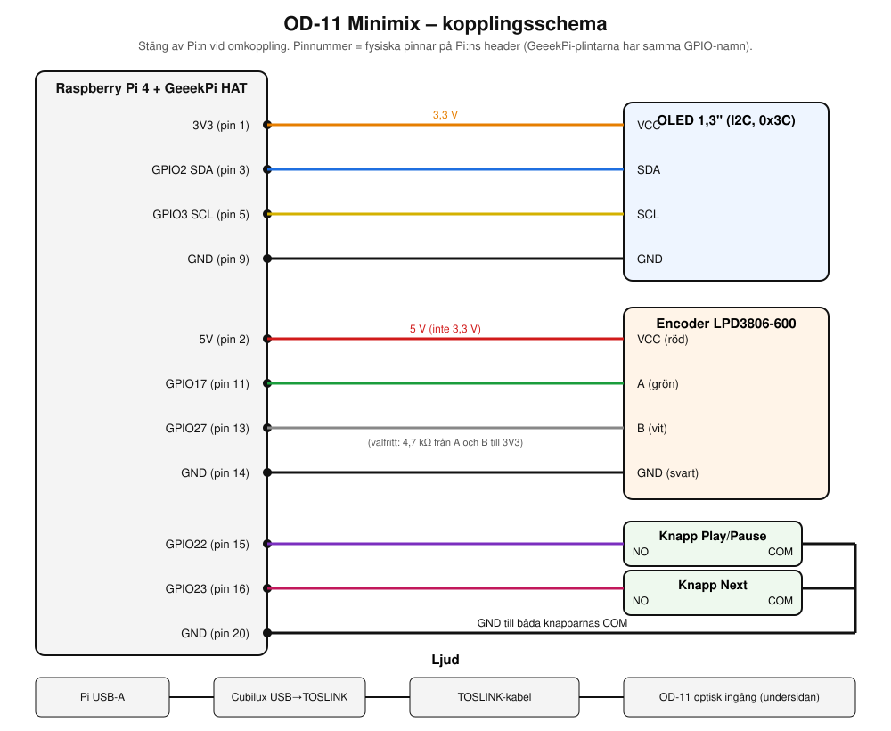
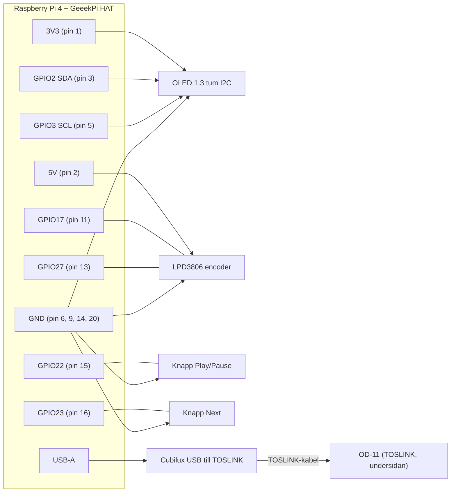

# OD-11 Minimix – kopplingsschema

> [!IMPORTANT]
> Stäng av Pi:n (dra ur strömmen) varje gång du kopplar om. Pinnummer nedan är **fysiska pinnar** (1–40) på Pi:ns header. GeeekPi-HAT:en har skruvplintar med samma GPIO-namn, så använd GPIO-numren där.

## Översikt



(Mermaid-version nedan.)



## 1. OLED-skärm (1.3" I2C, adress 0x3C)

| Skärm | Din kabelfärg | Pi / GeeekPi HAT | Fysisk Pin |
|---|---|---|---|
| **VCC** | **Orange** | **3V3** *(OBS: 3.3V, inte 5V)* | Pin 1 |
| **GND** | **Gul** | **GND** | Pin 9 (eller valfri GND) |
| **SDA** | **Ljusbrun** | **GPIO2** (SDA) | Pin 3 |
| **SCL** | **Röd** | **GPIO3** (SCL) | Pin 5 |

> [!WARNING]
> Använd **3,3 V** (pin 1), inte 5 V.

Kontroll efter uppstart: `sudo i2cdetect -y 1` ska visa `3c`.

## 2. Rotary encoder LPD3806-600

| Encoder (typisk färg) | Pi | Pin |
|---|---|---|
| Röd (VCC) | **5V** | 2 |
| Svart (GND) | GND | 14 |
| Grön (A) | GPIO17 | 11 |
| Vit (B) | GPIO27 | 13 |
| Skärm/skärmning (om finns) | GND | 14 |

Pull-up-motstånd (4,7 kΩ) är **valfria**. Du behöver inte köpa dem för att börja: Pi:ns interna pull-ups används automatiskt. Köp bara motstånd om encodern hoppar eller räknar fel vid snabb vridning:
- Ett motstånd mellan GPIO17 och **3V3** (pin 1).
- Ett motstånd mellan GPIO27 och **3V3** (pin 1).

```
3V3 ──[4.7k]──┬── GPIO17 ── Grön (A)
3V3 ──[4.7k]──┬── GPIO27 ── Vit (B)
```

> [!CAUTION]
> Koppla **aldrig** 5 V till GPIO 17 eller 27. Pull-upen ska gå till **3,3 V**, inte 5 V.

Test innan du kopplar in Pi:n på riktigt: mata encodern med 5 V och mät A och B mot GND med multimeter.
- Nära 0 V eller flytande: open-collector, allt är OK.
- Nära 5 V i vila: utgången är push-pull eller har en egen pull-up. Lägg då ett 1 kΩ-motstånd i serie på A och B, eller skriv till mig.

Går volymen åt fel håll: byt plats på A och B.

## 3. Tryckknappar (12 mm, förkopplade)

Knapparna har redan sladdar. Varje knapp har typiskt tre trådar: **COM**, **NO** och **NC**. Hitta dem med multimeter i läge ljud/kontinuitet. NO och COM ska bara ha kontakt medan du trycker. Låt NC vara.

| Knapp | COM | NO |
|---|---|---|
| Play/Pause | GND (pin 20) | GPIO22 (pin 15) |
| Next | GND (pin 20) | GPIO23 (pin 16) |

Inga motstånd behövs. Koden aktiverar interna pull-ups.

## 4. Ljud

```
Pi USB-A ──► Cubilux USB till TOSLINK ──► TOSLINK-kabel ──► OD-11 (undersidan)
```

- Optisk ingång på OD-11 är en vanlig stor, fyrkantig **TOSLINK** och sitter på **undersidan** (verifierat med din egen kabel). Ingen adapter behövs.
- Använd en blå USB-3-port (eller vilken USB-port som helst). Cubilux behöver ingen separat ström.
- Välj källa på OD-11 för optisk ingång.

## 5. Ström

Officiella 15,3 W USB-C-adaptern till Pi:n. Encoder och skärm drar bara Pi:ns egen ström.

## Pinnöversikt (bara de som används)

| Pin | Funktion | Går till | Kabelfärg |
|---|---|---|---|
| 1 | 3V3 | OLED VCC | **Orange** |
| 2 | 5V | Encoder VCC | Röd |
| 3 | GPIO2 SDA | OLED SDA | **Ljusbrun** |
| 5 | GPIO3 SCL | OLED SCL | **Röd** |
| 9 | GND | OLED GND | **Gul** |
| 11 | GPIO17 | Encoder A | Grön |
| 13 | GPIO27 | Encoder B | Vit |
| 14 | GND | Encoder GND | Svart |
| 15 | GPIO22 | Knapp Play/Pause | |
| 16 | GPIO23 | Knapp Next | |
| 20 | GND | Knappar COM | |

## Tips för 3D-printad låda

- Hål för: USB-C-ström, Ethernet (om du använder kabel), optisk kabel från Cubilux, encoderaxel (6 mm) och två knappar (12 mm).
- Encodern är ca 38 mm i diameter och långt bakåt. Placera den bredvid Pi:n, inte ovanpå.
- Ge Pi:n lite luft. Plast isolerar, så lägg på en liten kylfläns.
